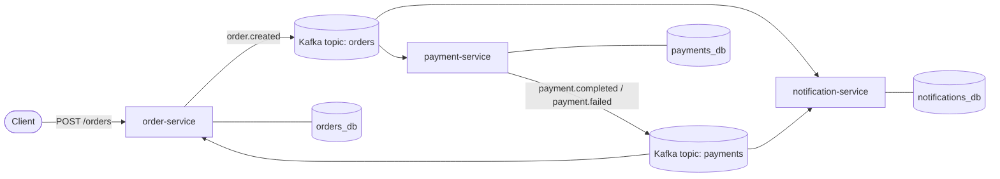

# OrderFlow: event-driven microservices on Kafka

[](https://github.com/Stuart-Vision/orderflow/actions/workflows/ci.yml)

Three Node.js microservices that work together only through Kafka events. An order placed over REST is charged by the payment service and confirmed to the customer by the notification service, with no service calling another directly.



## Design decisions

| Concern | Approach |
| --- | --- |
| **Reliable publishing** | **Transactional outbox.** A service writes its business row and the outgoing event to an `outbox` table in the same Postgres transaction. A relay publishes committed rows to Kafka and marks them sent, so an event is published if and only if the data was saved. `FOR UPDATE SKIP LOCKED` lets several replicas run the relay safely. |
| **Duplicate messages** | Kafka delivers **at least once**, so every consumer is **idempotent**: it records the event id in a `processed_events` table in the same transaction as its own writes, and skips ids it has already seen. The end-to-end test forces a redelivery and checks that no second payment is made. |
| **Ordering** | Messages are keyed by order id, so all events for one order land on the same partition and are processed in order. |
| **Fan-out** | Each service has its own consumer group. The notification service reads the same events as the order and payment services without either of them knowing it exists. |
| **Data ownership** | Database per service (`orders_db`, `payments_db`, `notifications_db`). Services share data only through events. |
| **12-factor config** | All configuration comes from environment variables; services are stateless processes with health checks and graceful shutdown (consumers leave their group cleanly on `SIGTERM`). |
| **Containers** | Multi-stage Dockerfiles (TypeScript compiled in a build stage; the runtime image holds only production dependencies and runs as a non-root user). |
| **Kafka** | Single-node Kafka 3.9 in **KRaft mode** (Kafka's built-in controller quorum, which replaces ZooKeeper). Idempotent producers. |

## Events

All events share one envelope:

```json
{ "id": "uuid", "type": "order.created", "occurredAt": "ISO-8601", "source": "order-service", "data": { "orderId": "…" } }
```

| Topic | Event | Producer | Consumers |
| --- | --- | --- | --- |
| `orders` | `order.created` | order-service | payment-service, notification-service |
| `payments` | `payment.completed`, `payment.failed` | payment-service | order-service, notification-service |

Payments above 1,000.00 are declined (`PAYMENT_LIMIT_CENTS`), so both outcomes can be seen end to end.

## Run it

```bash
docker compose up -d --build --wait
node tests/e2e.mjs
```

| Service | URL | Endpoints |
| --- | --- | --- |
| order-service | http://localhost:3001 | `POST /orders`, `GET /orders`, `GET /orders/:id`, `GET /health` |
| payment-service | http://localhost:3002 | `GET /payments?orderId=`, `GET /health` |
| notification-service | http://localhost:3003 | `GET /notifications?orderId=`, `GET /health` |

```bash
curl -X POST localhost:3001/orders -H 'Content-Type: application/json' \
  -d '{"customerId":"c1","items":[{"sku":"BOOK","quantity":2,"unitPriceCents":1500}]}'
```

## Tests and CI

GitHub Actions type-checks each service, then starts the full stack (Kafka, Postgres and the three services) with Docker Compose and runs `tests/e2e.mjs`, which:

1. creates 6 orders (4 within the payment limit, 2 above it) and waits for the events to flow through;
2. checks every order ends `PAID` or `PAYMENT_FAILED` as expected;
3. checks each order gets exactly two notifications;
4. forces a redelivery of an `order.created` event and checks that no second payment or notification is created.

## Project layout

```
services/
  order-service/         REST API, outbox relay, consumes payments
  payment-service/       consumes orders, outbox relay
  notification-service/  consumes both topics
  */src/platform.ts      config, logging, Postgres, Kafka, outbox, idempotent handler
db/init.sql              one database per service
docker-compose.yml       Kafka (KRaft), Postgres, services
tests/e2e.mjs            end-to-end test
.github/workflows/ci.yml CI pipeline
```

## Next steps

Deploy to AWS (containers on ECS Fargate with Amazon MSK for Kafka, or an AWS Lambda + API Gateway variant), add a dead-letter topic for poison messages, and add OpenTelemetry tracing across services.
